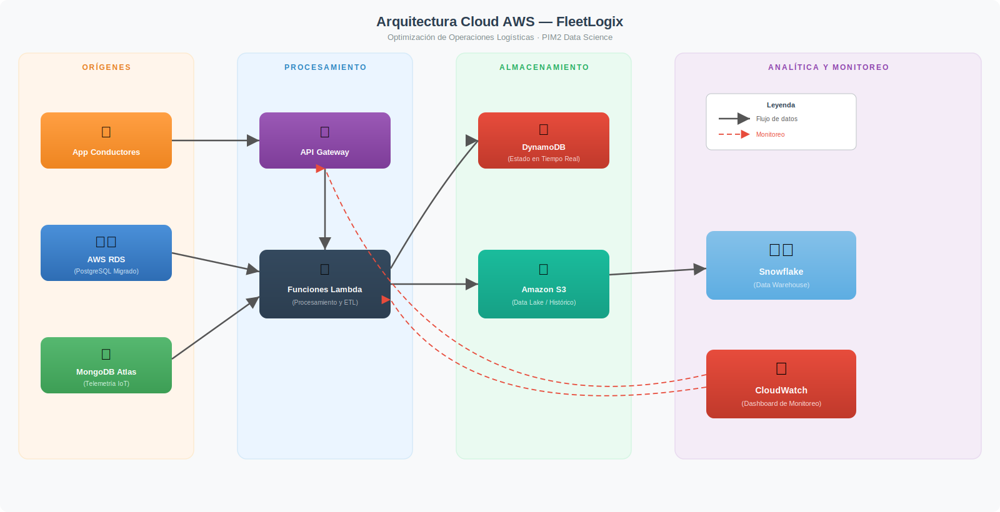

# FleetLogix – Pipeline de datos y arquitectura cloud

Proyecto Integrador M2 · Data Science – SoyHenry · **Cristian Atrio**

FleetLogix es una empresa de logística de última milla. Este proyecto moderniza su infraestructura de datos: pasa de un modelo transaccional *legacy* a una arquitectura analítica en la nube que unifica datos transaccionales (PostgreSQL) y telemetría IoT (MongoDB) en un Data Warehouse (Snowflake), con AWS S3 como zona de aterrizaje.

## Arquitectura

```
PostgreSQL (ERP) ──┐
                   ├─► Python + pandas (ETL) ─► AWS S3 (Landing Zone) ─► Snowflake (COPY INTO)
MongoDB Atlas (IoT)┘
```

- **PostgreSQL**: clientes, conductores, viajes y entregas.
- **MongoDB Atlas**: telemetría GPS simulada (coordenadas, velocidad, temperatura) en JSON.
- **Python / pandas**: limpieza de nulos, cruces, métricas agregadas y aplanado de los JSON de MongoDB.
- **S3**: CSV con *Batch ID* para auditoría, subidos con `boto3`.
- **Snowflake**: modelo en estrella (`DIM_CUSTOMER`, `DIM_DRIVER`, `FACT_DELIVERIES`, `FACT_TELEMETRY`, entre otras), cargado con `COPY INTO`.

Diagrama de la arquitectura serverless propuesta en AWS (Lambda, API Gateway, S3, DynamoDB, CloudWatch):



## Fases del proyecto

| Avance | Contenido | Archivos |
|---|---|---|
| 1 | Generación de un dataset sintético de +505.000 registros con integridad referencial en PostgreSQL | `scripts/A1-01_data_generation_estudiantes.py`, `scripts/Avance_1_DataGeneration.ipynb`, `scripts/fleetlogix_db_schema.sql` |
| 2 | 12 consultas SQL complejas e índices de optimización (mejoras de hasta 91 % en tiempos) | `scripts/12Queries.sql`, `scripts/A2-03_optimization_indexes.sql`, `scripts/Avance_2_SQLAnalysis.ipynb` |
| 3 | Modelo dimensional y pipeline ETL hacia Snowflake | `scripts/A3-04_dimensional_model.sql`, `scripts/A3-05_etl_pipeline_estudiantes.py`, `scripts/generador_telemetria.py`, `scripts/Avance_3_DataWarehouse.ipynb` |
| 4 | Arquitectura AWS serverless y funciones Lambda | `scripts/A4-06_aws_setup.py`, `scripts/A4-lambda_functions.py`, `lambda_functions/`, `scripts/Avance_4_CloudArchitecture.ipynb` |

## Resultados

- Pipeline ETL que procesa **232.867 registros** (≈222 k transaccionales + 10 k de telemetría IoT) en **~146 segundos**, sin errores.
- Ejecución **idempotente**: se puede repetir sin duplicar datos en el Data Warehouse.
- Costo mensual teórico de la arquitectura cloud por debajo de **USD 15**.

## Estructura del repositorio

```
.
├── scripts/              # Generación de datos, SQL, ETL, setup AWS y notebooks
├── lambda_functions/     # Extractores Lambda, diagrama y diccionario de datos
├── documentacion/        # Documentación técnica, logs y capturas
├── .env.example          # Plantilla de variables de entorno
└── README.md
```

## Requisitos

- Python 3.10+
- PostgreSQL local (base `fleetlogix`)
- Cuentas de MongoDB Atlas, AWS (S3) y Snowflake
- Librerías: `psycopg2`, `pandas`, `numpy`, `faker`, `tqdm`, `pymongo`, `boto3`, `snowflake-connector-python`, `cryptography`, `python-dotenv`

```bash
pip install psycopg2-binary pandas numpy faker tqdm pymongo boto3 snowflake-connector-python cryptography python-dotenv
```

## Configuración

Las credenciales **no** están en el código. Copiá la plantilla y completá tus valores:

```bash
cp .env.example .env
```

| Variable | Uso |
|---|---|
| `PG_PASSWORD` | Contraseña de PostgreSQL local |
| `AWS_ACCESS_KEY_ID`, `AWS_SECRET_ACCESS_KEY` | Acceso a S3 |
| `MONGO_URI` | Conexión a MongoDB Atlas |
| `RDS_MASTER_PASSWORD` | Contraseña maestra al crear la instancia RDS (`A4-06`) |
| `S3_BUCKET_NAME` | Bucket usado por las funciones Lambda |

Snowflake se autentica con **par de claves RSA**: generá tu clave privada y guardala en `.secrets/rsa_key.p8` (ruta ignorada por git). Ajustá `SNOWFLAKE_CONFIG` en `scripts/A3-05_etl_pipeline_estudiantes.py` con tu cuenta y usuario.

## Cómo ejecutarlo

```bash
# 1. Crear el esquema y generar los datos en PostgreSQL
psql -d fleetlogix -f scripts/fleetlogix_db_schema.sql
python scripts/A1-01_data_generation_estudiantes.py

# 2. (Opcional) Índices de optimización
psql -d fleetlogix -f scripts/A2-03_optimization_indexes.sql

# 3. Crear el modelo dimensional en Snowflake
#    ejecutar scripts/A3-04_dimensional_model.sql en tu worksheet

# 4. Generar telemetría en MongoDB y correr el ETL
python scripts/generador_telemetria.py
python scripts/A3-05_etl_pipeline_estudiantes.py
```

## Seguridad y gobernanza

- Credenciales gestionadas por variables de entorno; `.env`, `.secrets/` y las claves `*.p8` están en `.gitignore`.
- Principio de mínimo privilegio en Snowflake: el pipeline corre con `ETL_ROLE`, dueño (`OWNERSHIP`) de las tablas del esquema `ANALYTICS`, en lugar de `ACCOUNTADMIN`.

## Tecnologías

PostgreSQL · MongoDB Atlas · Snowflake · Python (pandas, psycopg2, pymongo, boto3) · AWS (S3, Lambda, API Gateway, DynamoDB, CloudWatch) · VS Code · DBeaver · draw.io

## Autor

**Cristian Atrio** – [@cristianatrio](https://github.com/cristianatrio)
